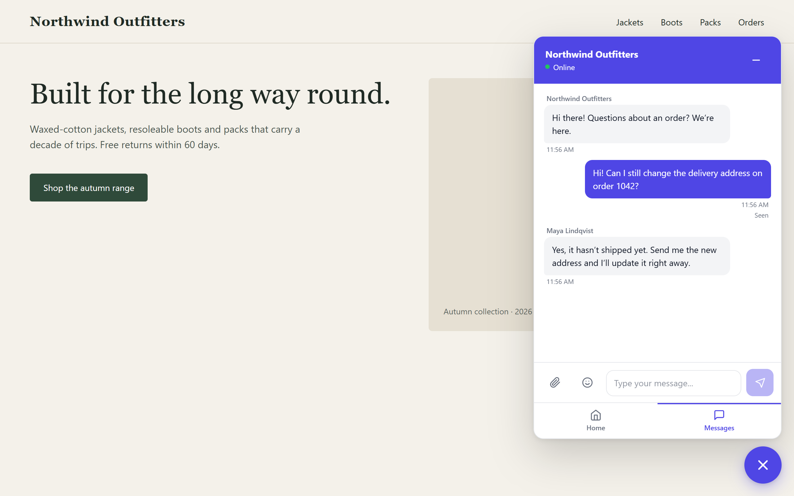
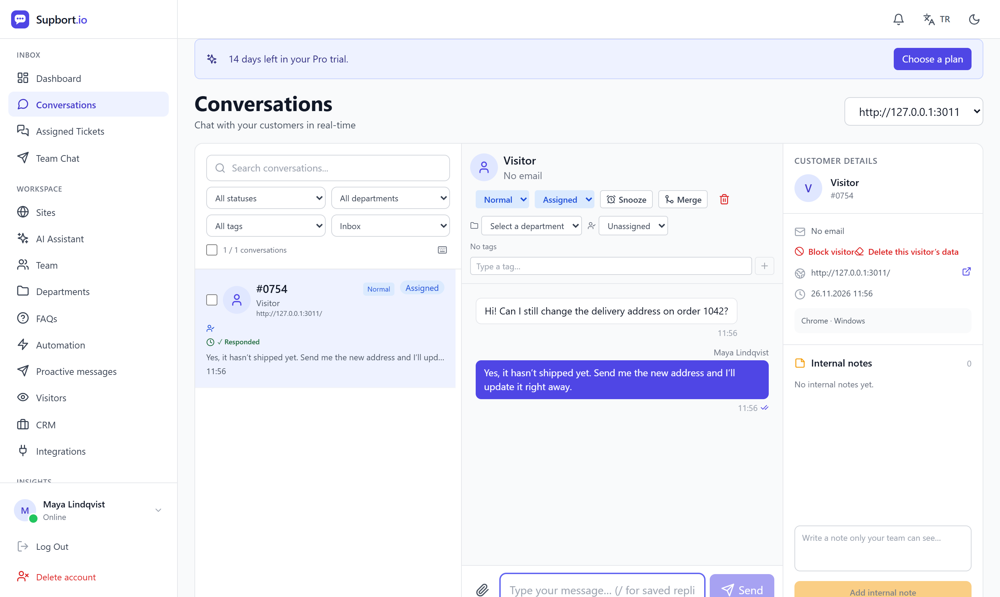

# Supbort.io

A live chat product for websites: a visitor writes from a chat bubble on any
site, and the business's agents answer from a shared inbox in real time, with
an optional FAQ assistant in between.

The repository is named `support.io`; the product's user-facing name is
Supbort.io ([backend/src/domain/brand.ts](backend/src/domain/brand.ts)). It
runs locally with Docker Compose and needs no cloud account or API key. There
is no public deployment.

| Visitor, on a customer's website | Agent, in the inbox |
|---|---|
|  |  |

Both screenshots come from the local stack described below: a synthetic shop
page with the install snippet, a new account, and one real exchange.

## Quick start

You need Git, Docker with Compose v2 (Docker Desktop on Windows and macOS)
and Node.js 22.12 or newer (`.nvmrc` names the version the images use). Every
command below runs in the repository root and is the same in PowerShell and
Bash unless two versions are shown.

```sh
git clone https://github.com/uhutsancar/support.io.git
cd support.io
node scripts/setup-env.mjs
docker compose up -d --build --wait
```

`setup-env.mjs` creates `.env` (ports for Compose and a development Web Push
key pair) and `backend/.env` (a random `JWT_SECRET`). It never overwrites a
file that already exists. Both files are git-ignored.

The first start builds the images, compiles the chat bubble and runs the 31
database migrations; allow several minutes. `--wait` returns once every
service reports healthy. To check by hand:

```sh
# Bash
curl http://localhost/ready
```

```powershell
# PowerShell
Invoke-RestMethod http://localhost/ready
```

Both print `{"status":"ready"}` when the stack is up.

| Service | Open on this machine | Port in the container | Set in `.env` |
|---|---|---|---|
| Caddy: panel, API, Socket.IO, `widget.js` | <http://localhost> | 80 | `PROXY_PORT=80` |
| Panel (Vite dev server) | <http://localhost:5173> | 5173 | `ADMIN_PORT=5173` |
| Backend API | <http://localhost:5000> | 3000 | `BACKEND_PORT=5000` |
| PostgreSQL 16 | `127.0.0.1:5432` | 5432 | `POSTGRES_PORT=5432` |
| Redis 7 | `127.0.0.1:6381` | 6379 | `REDIS_PORT=6381` |

Use the Caddy address. If PostgreSQL already runs on this machine, set
`POSTGRES_PORT=5433` (any free port works; the same goes for the others).

Optional demo data, a seeded workspace with conversations, agents and reports:

```sh
npm run demo:seed     # refuses when the demo workspace already exists
npm run demo:reset    # deletes only the demo workspace, then seeds it again
```

## Try a conversation

You need two separate browser windows: a normal one for the agent and a
private one for the visitor, so the two do not share cookies.

**Quick tour with the demo account.** After `npm run demo:seed`, sign in at
<http://localhost/en/login> as `owner@demo.support.io` / `Demo1234!`. The
seeded inbox, reports, CRM and team are there to browse.

**From a new account, the full path:**

1. Open <http://localhost/en/register>, fill in name, e-mail and password and
   press **Sign Up**. Any address works; nothing is sent.
2. Find the verification link. Development mail is printed to the backend log
   and kept in memory:
   ```sh
   docker compose logs backend | grep verify-email          # Bash
   docker compose logs backend | Select-String verify-email   # PowerShell
   ```
   or open `http://localhost/api/dev/outbox?to=<your address>`. Opening the
   link verifies the address and signs you in.
3. Onboarding asks how you plan to use the product, then for **Your website
   URL**: enter `http://localhost:3001`. Press **Next** through the remaining
   steps and **Complete**.
4. Under **Sites**, copy the **Installation Code**. It names the public
   address the product will have; for local use change its `src` to
   `http://localhost/widget.js`.
5. Make a page for it. Save the snippet inside a minimal `shop.html`
   (`<!doctype html><html><body><h1>My shop</h1> …snippet… </body></html>`)
   and serve it on port 3001 from the same folder:
   ```sh
   node -e "require('http').createServer((q,s)=>s.end(require('fs').readFileSync('shop.html'))).listen(3001)"
   ```
6. In the private window open <http://localhost:3001>, click the bubble,
   start a chat and write a message.
7. In the agent window open **Conversations**. The new conversation appears
   at the top; open it, press **Claim Ticket** if shown, type in **Type your
   message...** and press Enter. The answer appears in the visitor's bubble
   at once.
8. Reload the visitor page: the history is still there. Stop and start the
   stack (`docker compose stop`, then `docker compose up -d --wait`) and it is
   still there, as are files sent in the chat.

## Features and optional services

Everything in the core column runs on the local stack without a key.

| Area | Works locally without a key | Needs for real use | Verified here |
|---|---|---|---|
| Chat bubble | One script tag, Shadow DOM, 8 languages, pre-chat and offline forms, ratings, file sharing, identity verification | — | Browser suite, phones and tablet emulated |
| Inbox and team | Real-time inbox, assignment, notes, tags, snooze, merge, search, saved replies, roles, invitations, departments, team chat | — | Backend and browser suites |
| Automation and insight | Rules, proactive messages, business hours, SLA, analytics, CSV export, CRM, audit log, help center | — | Backend suite |
| Accounts | Sign-up with e-mail verification, password reset, TOTP two-factor, data export and deletion | — | Backend and browser suites |
| E-mail | Printed to the log and kept at `/api/dev/outbox` | `MAIL_PROVIDER=smtp`, `SMTP_HOST`, `SMTP_PORT`, `SMTP_USER`, `SMTP_PASS`, `MAIL_FROM` | Console outbox only; real delivery not tested |
| File storage | Local disk (`backend/uploads`) | `UPLOAD_STORAGE=s3`, `S3_BUCKET`, `S3_REGION`, `AWS_ACCESS_KEY_ID`, `AWS_SECRET_ACCESS_KEY` (`S3_ENDPOINT` for R2/MinIO) | Local disk only |
| FAQ assistant (Google Gemini) | Off; conversations go to agents | `GEMINI_API_KEY` | Against a stand-in model (`e2e/fake-gemini.mjs`); the real API was not called |
| Billing (Paddle) | Checkout off; plans and limits enforced; signed test webhooks accepted | `BILLING_ENABLED=true`, `PADDLE_API_KEY`, `PADDLE_CLIENT_TOKEN`, `PADDLE_WEBHOOK_SECRET`, price ids | Signed sandbox-shaped webhooks; no real payment |
| Sign in with Google | A stand-in account chooser at `/api/dev/google` | `GOOGLE_CLIENT_ID`, `GOOGLE_CLIENT_SECRET` | Stand-in only |
| Web Push | Kept in memory (`/api/dev/push-outbox`) with the local key pair | `VAPID_PUBLIC_KEY`, `VAPID_PRIVATE_KEY`, `VAPID_SUBJECT`, `PUSH_TRANSPORT` unset | Chrome DevTools delivery in the browser suite |
| Slack, Telegram, webhooks | Kept in memory (`/api/dev/integration-outbox`) | Workspace credentials entered in the panel | In-memory delivery only |
| WordPress plugin | `integrations/wordpress/` | A WordPress site | Packaged locally; `e2e/tests/wordpress-plugin.spec.ts` runs against a throw-away WordPress container (not run in this verification) |
| Shopify theme extension | `integrations/shopify/` | A Shopify store | Packaged locally; no automated test; not tried on Shopify |
| Google Tag Manager template | `integrations/gtm/` | A GTM container | Packaged locally; `gtm-template.spec.ts` simulates it in the browser |

None of the three install channels has been published to a marketplace.
`node integrations/release.mjs <domain>` writes ready-to-upload copies with
the production domain filled in to `integrations/dist/`.

**What the assistant sends to Gemini** (when a key is set and the business
has switched it on): the site's FAQ entries, on plans with knowledge sources
the best-matching passages of the site's pages and uploaded PDFs, and the
visitor's latest message. E-mail addresses, phone numbers and long digit runs
are masked first; a message with a card number, IBAN or Turkish ID number is
not sent at all and goes to a person. No name, e-mail or earlier message is
sent ([privacy.ts](backend/src/services/assistant/privacy.ts),
[knowledge.ts](backend/src/services/assistant/knowledge.ts)).

## Architecture

```
admin-panel/          React + Vite: marketing pages and the agent panel
backend/
  src/server.ts       Express + Socket.IO entry point
  src/routes/         REST API (/api/*)
  src/socket/         Socket.IO namespaces: widget and admin
  src/widget/         the chat bubble (compiled to backend/public/widget.js)
  src/db/             PostgreSQL pool, migrations, queries, demo seed
  scripts/            schema, test, load-test and role-check tools
docker/postgres/      role and extension preparation for PostgreSQL
e2e/                  Playwright suite and the stand-in AI model
integrations/         WordPress plugin, Shopify extension, GTM template
scripts/              setup, verification, image scan, production tooling
```

How one visitor message travels:

1. The bubble loads `widget.js` from the backend and asks for a widget
   session for its site key; the backend checks that the page's origin is one
   the site allows and returns a signed visitor token.
2. The bubble connects to the widget namespace of Socket.IO with that token
   and sends `send-message` with a client message id. One visitor's messages
   are handled strictly in order
   ([socket/handlers/widget.ts](backend/src/socket/handlers/widget.ts)).
3. The backend stores the message in PostgreSQL (opening the conversation on
   the first one), then acknowledges it to the bubble. A resend with the same
   client message id returns the same message instead of a second one.
4. The message is emitted to the agents of that site in the admin namespace;
   an agent restricted to other sites never receives it. Agents who are not
   connected can get a Web Push notification.
5. A client that was offline asks for the messages `after` the last one it
   has and receives only its own conversation's.

Redis carries the Socket.IO adapter (so several backend processes share
rooms), rate-limit counters and a short-lived read cache. Each of these falls
back to the process itself when Redis is unreachable. The panel and the
bubble are separate builds: the panel is a single-page app served by Vite in
development, the bubble a dependency-free script served by the backend.

## Verification

All checks run locally; no hosted CI is part of this setup. Results below are
from 2026-11-26, from a fresh clone of the `portfolio-hardening` branch on
Windows 11 with Docker Desktop (Engine 29.9.3, Compose 5.7.1), Node 24.22.1
on the host and Node 22.23.5 in the images.

| Check | Command (repository root unless noted) | Result |
|---|---|---|
| Typecheck, lint, format, schema, locales, hard-coded text, production `npm audit`, removed-AI and secret scans | `npm run install:all` once, then `npm run verify` | 13 of 13 pass. Lint: 0 errors; 100 warnings in `backend`, 232 in `admin-panel` |
| The above plus builds, size budgets, public IPs and server secrets in built assets | `npm run verify -- --build` | 18 of 18 pass. `widget.js` 25.6 KB gzip (budget 35 KB); panel first load 148.2 KB gzip (budget 250 KB) |
| Backend integration suite, against the running stack | `cd backend` then `npm run test:compose` | 320 tests: 318 pass, 2 skipped, 0 fail |
| Database roles, migrations, backup and restore | `cd backend` then `npm run test:db-roles` | 3 of 3 pass |
| Browser suite | `cd e2e` then `npm run test:stack` | 41 tests: 39 pass, 1 skipped, 1 flaky (see below) |
| First conversation only | `cd e2e` then `npm run test:stack -- first-chat --project=desktop-chrome` | Pass |
| Image scan | `npm run scan:images` | See the limits below |

`npm run install:all` runs `npm ci` in `backend`, `admin-panel` and `e2e`.
The backend and browser suites create tenants; point them at a stack whose
data you do not mind, and run them one at a time on an otherwise idle
machine. `test:stack` starts the stand-in AI model for the run and restores
the backend's settings afterwards. `test:db-roles` starts a throw-away
PostgreSQL container and removes it.

Limits, stated plainly:

- Backend skips: the assistant kill-switch test needs `REDIS_URL` in the
  test process, and the home-page head test needs the API to serve a built
  panel (the development stack serves Vite). Five more tests need
  `admin-panel/dist` and are skipped until `npm run build:admin` has run.
  A first run started right after the browser suite failed 32 tests because
  PostgreSQL restarted mid-run under heavy disk load; the same suite on the
  idle stack passed as above.
- Browser: the projects were Chrome (34 desktop tests), WebKit as
  iPhone 14, iPad and desktop Safari, Chrome as Pixel 7, and Firefox. No
  physical device was used. The WordPress spec is skipped without `WP_URL`.
  `knowledge.spec.ts` failed once when its accessibility scan caught a
  notification mid-animation, and passed when run again.
- The 332 lint warnings are mostly `no-explicit-any` and intentional
  sequential `await`s; none is in a code path that changes authorization,
  uploads, billing or socket handling.
- Image scan (Trivy 0.58.1): the application image built from
  `backend/Dockerfile.prod` and the Redis and Alpine images have no fixable
  HIGH or CRITICAL finding. Open: Debian krb5, zstd and zlib fixes not yet in
  the official `postgres:16.15-trixie` image, Go standard-library findings in
  its `gosu` (partly accepted in `.trivyignore` until 2027-01-15), one
  `golang.org/x/net` finding in Caddy 2.11.9, and npm's own bundled packages
  in the Node build image (npm is not copied into the application image).
- Load and Lighthouse figures were not re-measured (`npm run loadtest` in
  `backend`, `lighthouserc.json`).

## Troubleshooting

| Symptom | Cause and fix |
|---|---|
| `port is already allocated` | Another program holds a port. Change it in `.env` (table above) and run `docker compose up -d --wait` again. Avoid ports browsers refuse, such as 5060, 5061 and 6000: the panel calls the backend port directly. |
| No verification mail | Nothing is sent in development. Use `docker compose logs backend` or `/api/dev/outbox?to=<address>` (step 2 above). |
| The bubble does not appear | The snippet's `src` still names the public domain (change it to `http://localhost/widget.js`), or the page's origin is not the site's address. Check **Sites** and the browser console. |
| Backend cannot reach the database | Inside Compose the backend uses `postgres:5432`; `DATABASE_URL` in `backend/.env` is ignored there. Host tools use `127.0.0.1:${POSTGRES_PORT}`. |
| `PostgreSQL schema is not ready` | A migration has not run or was edited. In development the backend migrates on start: read the first lines of `docker compose logs backend`. |
| `Demo organizasyonu ("Acme Yazılım (Demo)") zaten var.` | The demo workspace exists. `npm run demo:reset` replaces only it; other accounts stay. |
| Restart without losing data | `docker compose stop` / `docker compose up -d`. Data lives in the `postgres_data` volume and uploads in `backend/uploads`. `docker compose down -v` deletes the volumes and every local account. |
| A second copy on the same machine | Set `COMPOSE_PROJECT_NAME` and five different ports in that copy's `.env`. Projects share no containers, volumes or networks. |
| A dependency change is not picked up | The `node_modules` volumes keep old packages: `docker compose down`, then `docker volume rm <project>_backend_node_modules <project>_admin_node_modules`, then start again. |

## Maintenance, production tooling and license

**Dependency updates.** Dependabot opens weekly npm, Docker and Compose PRs
([.github/dependabot.yml](.github/dependabot.yml)). Before merging one, check
out the branch and run `npm run install:all`, `npm run verify -- --build`,
the backend and browser suites, and `npm run scan:images` for an image bump.

**Database operations.** Production uses three roles: an administrator, a
migration role that owns the schema, and a runtime role that only reads and
writes rows; an optional backup role only reads.
[docker/postgres/init-roles.sh](docker/postgres/init-roles.sh) prepares them
and can be re-run on an existing or restored database. A database dump does
not contain uploaded files: on a server they live in the `uploads_data`
volume (or the S3 bucket) and are backed up separately.

**Production tooling, not a supported install path.**
`docker-compose.prod.yml`, `Caddyfile.prod` and the shell scripts in
[scripts/](scripts/) (deploy, rollback, server bootstrap, firewall, backups,
watchdog) were written for a single VPS behind Cloudflare, deploying images
by digest from a registry, with the first deploy expecting a backup of the
running database. They are kept for reference and were not rehearsed for
this version; the backup and restore role handling in them matches the
contract above.

**License.** Not decided yet. The root and backend `package.json` files say
`MIT`, but the repository has no `LICENSE` file or copyright notice; the
owner has to choose and add one.
